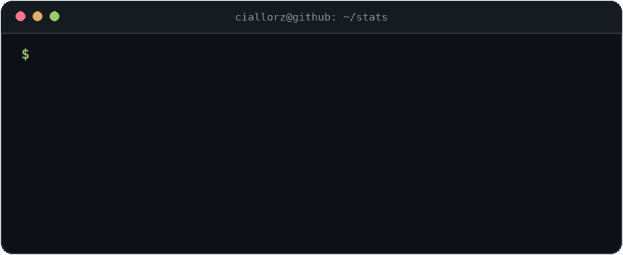

<h1 align="center">✨ Hi there, I'm CiallorZ ✨</h1>

<p align="center">
  <a href="https://github.com/CiallorZ">
    
  </a>
</p>

<p align="center">
  <i>「 コードも、セキュリティも、全力で。」</i><br/>
  二次元 × 技术宅 —— 白天写代码，夜里补番 (๑•̀ㅂ•́)و✧
</p>

<p align="center">
  <a href="#-languages">💻 Languages</a> ·
  <a href="#-tech-stack">🧰 Tech Stack</a> ·
  <a href="#-github-stats">📊 Stats</a> ·
  <a href="#-contribution-snake">🐍 Snake</a>
</p>

```bash
$ whoami
CiallorZ — full-stack developer & network security enthusiast

$ cat ./focus.txt
frontend · backend · AI · security — build, break, fix, repeat

$ uptime
coding since 2014, still shipping 🚀

$ tail -1 ./now.log
exploring AI × security — ops by day, builder by night
```

---

### 💻 Languages

<p>
  
  
  
  
  
  
  
  
</p>

### 🧰 Tech Stack

#### 🌐 Frontend

<p>
  
  
  
  
  
  
  
  
</p>

#### ⚙️ Backend

<p>
  
  
  
  
  
  
</p>

#### 🤖 AI & Machine Learning

<p>
  
  
  
  
  
  
  
  
  
</p>

#### ⚡ AI Compute & Infrastructure

<p>
  
  
  
  
  
  
</p>

#### 🗄️ Database & Middleware

<p>
  
  
  
  
  
</p>

#### ☁️ Cloud Native

<p>
  
  
  
  
  
  
  
</p>

#### 🛡️ Network Security

<p>
  
  
  
  
</p>

#### 🔧 DevOps & Tools

<p>
  
  
  
  
  
  
</p>

### 📊 GitHub Stats

<p align="center">
  
  
</p>

<p align="center">
  
  
</p>


<p align="center">
  
</p>

### 🐍 Contribution Snake

<picture>
<source media="(prefers-color-scheme: dark)" srcset="https://raw.githubusercontent.com/CiallorZ/CiallorZ/output/github-contribution-grid-snake-dark.svg" />
<source media="(prefers-color-scheme: light)" srcset="https://raw.githubusercontent.com/CiallorZ/CiallorZ/output/github-contribution-grid-snake.svg" />

</picture>

---

<p align="center">
  <i>Thanks for stopping by~ またね！🌸</i>
</p>
